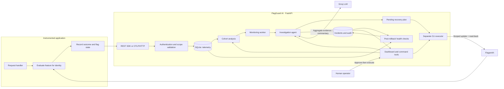
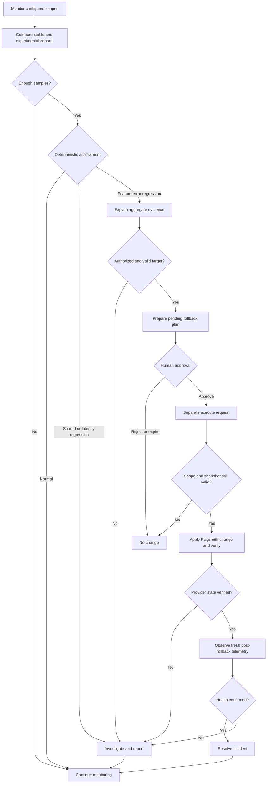
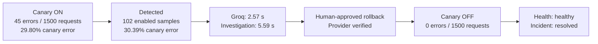

# FlagGuard AI

**Feature-aware incident detection, AI-assisted investigation and human-approved recovery for Flagsmith rollouts.**

    

[Architecture](#system-architecture) · [Agent workflow](#agent-workflow) · [Getting started](#getting-started) · [Integrations](#integrations) · [Benchmarks](#evaluation) · [Safety](#security-and-limitations)

## Why FlagGuard?

A 10% canary rollout with a 30% failure rate can produce an overall error rate of only 3%. A basic global 5% error alert may miss the regression entirely. FlagGuard compares requests by their **actual evaluated feature state**, detects abnormal cohorts, explains the evidence using an LLM and prepares a narrowly scoped recovery proposal. A human must approve and separately execute the change.

FlagGuard is a working single-workspace prototype, not a hosted multi-tenant or production-certified incident management service.

## Capabilities

| Capability | Implementation |
| --- | --- |
| Feature-aware monitoring | Enabled/disabled cohort comparison, configurable error and p95 latency thresholds |
| Autonomous investigation | Opt-in monitoring worker; structured reports with measured facts and Groq commentary |
| Natural-language assistant | Bounded tools for metrics, flag status, investigation and incident history |
| Controlled recovery | Flagsmith CLI, allowlisted targets, exact-plan approval, stale-state checks and verification |
| Incident lifecycle | Persistent deduplication, post-rollback error/exposure checks and resolution |
| Telemetry | REST, Python and Node.js clients, uncompressed OTLP/HTTP JSON and protobuf |
| Workspace | Browser dashboard for metrics, flags, incidents, approvals and agent commands |

## System architecture



The application evaluates flags through Flagsmith and reports outcomes without sending payment details. FastAPI validates incoming events and stores them in SQLite. A deterministic engine calculates cohort error rates and nearest-rank p95 latency. The monitor detects anomalies; the LLM explains them but does not authorize actions. The separate executor applies only explicitly approved, verified changes.

## Agent workflow



The autonomous worker scans configured services and flags approximately every 15 seconds. Error regressions can produce pending rollback plans; shared failures and latency-only anomalies are investigated without automatic rollback. Recovery planning is disabled unless CLI writes are enabled. The language model cannot approve or execute a plan.

For component responsibilities and security boundaries, see [architecture notes](docs/architecture.md).

## Getting started

### Prerequisites

- Python 3.12 and Git
- Node.js 22+ for JavaScript integrations
- Flagsmith project and environment for live flag operations
- Flagsmith CLI available on PATH for management operations
- Groq API key for AI explanations and natural-language commands

### Install locally

```powershell
git clone -b feature/flagsmith-executor https://github.com/Vinilnaik3705/FlagGuard-AI.git
cd FlagGuard-AI
python -m venv .venv
.\.venv\Scripts\Activate.ps1
python -m pip install -r requirements.txt
Copy-Item .env.example .env
```

On Linux/macOS, activate with `source .venv/bin/activate` and copy with `cp .env.example .env`.

Generate two different random secrets (run twice):

```bash
python -c "import secrets; print(secrets.token_urlsafe(32))"
```

Set the administrator and telemetry secrets in `.env`. Keep write operations disabled.

```dotenv
FLAGGUARD_API_KEY=<administrator-secret>
FLAGGUARD_TELEMETRY_KEY=<different-ingestion-secret>
FLAGGUARD_REQUIRE_SEPARATE_KEYS=true
FLAGGUARD_ENABLE_WRITES=false
FLAGGUARD_DB=flagguard.db
FLAGGUARD_ALLOWED_SERVICES=payment
FLAGGUARD_ALLOWED_FEATURE_NAMES=new_checkout
FLAGGUARD_TELEMETRY_ENVIRONMENT=development
FLAGGUARD_ENFORCE_TELEMETRY_SCOPE=true
FLAGGUARD_MONITOR_ENABLED=true
FLAGGUARD_RATE_LIMIT_ENABLED=true
FLAGGUARD_TELEMETRY_RPM=3000
FLAGGUARD_COMMAND_RPM=30
FLAGGUARD_RETENTION_ENABLED=true
FLAGGUARD_TELEMETRY_RETENTION_DAYS=7
```

For live Flagsmith and Groq operations add these settings using your own development credentials and verified identifiers:

```dotenv
FLAGSMITH_EXECUTION_PROVIDER=cli
FLAGSMITH_ENVIRONMENT_KEY=<sdk-environment-key>
FLAGSMITH_ADMIN_API_KEY=<management-api-key>
FLAGSMITH_ENVIRONMENT_ID=<verified-development-environment-id>
FLAGSMITH_PROJECT_ID=<project-id>
FLAGGUARD_ALLOWED_SEGMENT_IDS=<approved-segment-id>
FLAGGUARD_CANARY_SEGMENT_ID=<configured-canary-id>
FLAGGUARD_REQUIRE_SEGMENT_EVIDENCE=false
GROQ_API_KEY=<groq-api-key>
LLM_MODEL=openai/gpt-oss-20b
```

Strict segment attribution is optional: enable `FLAGGUARD_REQUIRE_SEGMENT_EVIDENCE=true` only when your instrumentation supplies actual evaluation metadata. Never infer a segment ID from a Boolean flag value.

```bash
python -m uvicorn flagguard.main:app --env-file .env --port 8000
```

Open [http://localhost:8000](http://localhost:8000) and use **Connection** with the administrator key (or optional distinct viewer key for read-only metrics). Interactive API documentation is at [http://localhost:8000/docs](http://localhost:8000/docs).

### Detection policy

| Environment variable | Default | Meaning |
| --- | ---: | --- |
| FLAGGUARD_ANALYSIS_WINDOW_SECONDS | 300 | Rolling analysis window |
| FLAGGUARD_MIN_COHORT_REQUESTS | 100 | Minimum samples per cohort |
| FLAGGUARD_ERROR_THRESHOLD_PERCENT | 5 | Error threshold (%) |
| FLAGGUARD_ERROR_GAP_POINTS | 2 | Minimum cohort error gap (percentage points) |
| FLAGGUARD_LATENCY_RATIO | 2 | Minimum p95 latency ratio |
| FLAGGUARD_LATENCY_DELTA_MS | 100 | Minimum absolute p95 increase |

Server errors are HTTP status codes >= 500. Thresholds are configurable heuristics, not statistical significance tests.

## Integrations

### Python

From the repository root (server-side only):

```python
from dotenv import load_dotenv
from flagguard_sdk import Client

load_dotenv()
guard = Client("payment", "development")
guard.record({"new_checkout": False}, 200, 45)
# Optional fourth argument: actual evaluated segment mapping, if available.
```

An asynchronous `arecord` method is also available.

### Node.js

```javascript
const { FlagGuardClient } = require('./sdk/javascript/index.cjs');
const guard = new FlagGuardClient({
  service: 'payment',
  environment: 'development'
});
async function recordOutcome() {
  return guard.record({ new_checkout: false }, 200, 45);
}
recordOutcome().catch(console.error);
```

Load the telemetry key into the server process environment. These clients are repository-local modules, not published package-registry SDKs.

### OpenTelemetry

Send uncompressed OTLP/HTTP JSON or protobuf traces to `/v1/traces` with the telemetry bearer key. Set resource attributes `service.name` and `deployment.environment.name`. On request spans record:

```python
span.set_attribute("flagguard.request", True)
span.set_attribute("flagguard.flag.new_checkout", False)
span.set_attribute("http.response.status_code", 200)
# Optional: flagguard.segment.new_checkout = actual evaluated segment ID
```

The receiver derives latency from span timestamps, rejects invalid or out-of-scope spans and deduplicates trace/span IDs. OTLP/gRPC, compressed payloads, metrics and logs are not supported.

### API reference

| Method | Endpoint | Access |
| --- | --- | --- |
| GET | /api/health | Public |
| POST | /api/v1/telemetry | Telemetry |
| POST | /v1/traces | Telemetry |
| GET | /api/v1/analysis | Administrator / viewer |
| GET | /api/v1/monitor/incidents | Administrator / viewer |
| POST | /api/v1/investigate | Administrator |
| POST | /api/v1/command | Administrator |
| POST | /api/v1/cli-changes | Administrator |
| GET | /api/v1/cli-changes/{id} | Administrator |
| POST | /api/v1/cli-changes/{id}/approval | Administrator |
| POST | /api/v1/cli-changes/{id}/execute | Administrator |
| GET | /api/v1/audit | Administrator |

## Evaluation

### Live controlled recovery experiment

The [OpenTelemetry Astronomy Shop](https://github.com/open-telemetry/opentelemetry-demo) payment service was instrumented to inject synthetic failures in the enabled checkout cohort. The experiment used a 10% Flagsmith canary and a human-approved segment rollback.

| Metric | Before rollback | After rollback |
| --- | ---: | ---: |
| Requests | 1,500 | 1,500 |
| Experimental requests | 151 | 0 |
| Stable requests | 1,349 | 1,500 |
| Failed requests | 45 | 0 |
| Overall error rate | 3.00% | 0.00% |
| Canary error rate | 29.80% | Not applicable |



| Recorded timing | Seconds |
| --- | ---: |
| Groq API call | 2.57 |
| Full investigation | 5.59 |
| Incident creation to verified rollback (includes operator delay) | 264 |
| Verified rollback to health confirmation | 313 |
| Incident creation to resolution | 577 |

These are user-observed measurements from one controlled trial, not production SLOs. The fault start timestamp was not captured, so live MTTD and fault-to-recovery MTTR cannot be established. The live rollback used a configured canary binding rather than independently discovered segment membership.

### Offline comparative benchmark

20 seeded runs for each of five scenarios, repeated for three methods (300 runs). Identical synthetic traffic per seed and scenario; 30-second analysis window; fault onset at second 30; automated scans every 15 seconds.

| Metric | Manual review proxy | Basic global rule | FlagGuard |
| --- | ---: | ---: | ---: |
| Incident detection | 20/60 | 20/60 | 60/60 |
| Detection rate | 33.33% | 33.33% | 100% |
| Final classification accuracy | 60% | 60% | 100% |
| False alerts on negative runs | 0/40 | 0/40 | 0/40 |
| Mean simulated detection delay (detected only) | 29 s | 14 s | 14 s |

Reproduce locally:

```bash
python -c "import json; from benchmarks.replay import run; open('benchmark_results.json','w',encoding='utf-8').write(json.dumps(run(),indent=2))"
```

The manual proxy is a 60-second periodic global check, not measured human performance. The global-rule baseline is a simple 5% aggregate error alert, not a comparison against a full observability platform. These results show the benefit of cohort-aware deterministic detection, not a measured advantage from the LLM.

## Testing

```bash
python -m pytest -q
node --check sdk/javascript/index.cjs
```

The last user-confirmed suite passed 108 tests before the live timing instrumentation change. Tests cover detection, API authentication, approvals, stale plans, lifecycle, recovery health, OTLP, SDKs and segment attribution. Test fixtures isolate local credentials and temporary databases. Provider interactions in automated recovery tests are mocked.

## Security and limitations

- Separate administrator, telemetry and optional viewer bearer credentials; no full user identity or tenant isolation.
- Scope allowlists, bounded request bodies, optional process-local rate limits and telemetry retention.
- Human approval and separate execution; ten-minute plan expiry, snapshot comparison and provider read-back.
- AI output is non-authoritative; command tools cannot approve or execute changes.
- SQLite audit history is persistent but not tamper-proof; telemetry producers can fabricate events within permitted scopes.
- Recovery health checks evaluate fresh error rates, sample sufficiency and feature exposure, not latency recovery or proof of causation.
- Analysis is bounded to the latest 10,000 matching events. The monitor is intended for a single process.
- Keep secrets and local databases out of version control. Use HTTPS and an appropriate authentication boundary before remote exposure; do not expose this prototype as a public multi-tenant service.

## Repository layout

```text
flagguard/                 FastAPI, analysis, agent, executor, monitor and UI
flagguard_sdk.py           Python telemetry client
sdk/javascript/            Node.js telemetry client
examples/astronomy-shop/   Optional synthetic payment-service adapter
benchmarks/replay.py       Seeded offline benchmark
tests/                     Automated regression and integration tests
docs/architecture.md       Component and security architecture
.env.example               Local configuration starter
requirements.txt           Python dependencies
```

## Acknowledgements

Built around [Flagsmith](https://www.flagsmith.com/), [OpenTelemetry](https://opentelemetry.io/), [FastAPI](https://fastapi.tiangolo.com/) and [Groq](https://groq.com/). The optional Astronomy Shop integration uses a separate upstream checkout; retain its Apache-2.0 notices.
