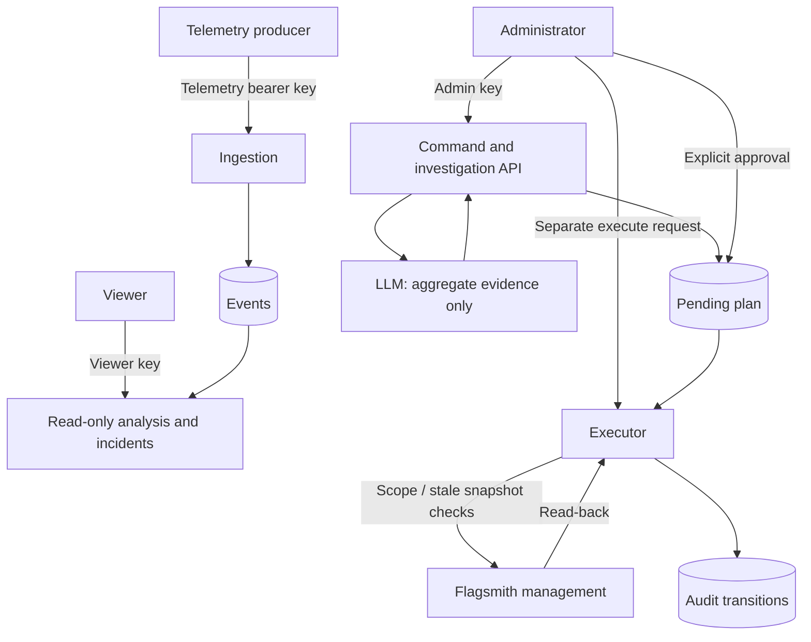

# FlagGuard AI architecture

See the [README](../README.md#system-architecture) for the system diagram and [agent workflow](../README.md#agent-workflow).

## Component responsibilities

| Component | Responsibility |
| --- | --- |
| main.py | FastAPI routes, bearer authentication, event validation and analysis, worker lifecycle |
| core.py | Deterministic cohort metrics and configurable detection rules |
| otlp.py | Uncompressed JSON/protobuf span ingestion, timestamp checks and deduplication |
| telemetry_scope.py / limits.py | Optional ingestion allowlists, request-size and process-local rate limits |
| monitor.py | Periodic scans, persistent incident deduplication and lifecycle |
| agent.py / incident_report.py | Investigation, aggregate evidence, non-authoritative AI explanation and recovery proposal |
| commands.py | Bounded natural-language tool calls; no approval or execution tools |
| segment_evidence.py | Optional conservative selection from application-reported segment attribution |
| cli_executor.py / cli_provider.py | Scoped plans, explicit approval, snapshot checks, CLI execution and provider verification |
| recovery_health.py | Bounded post-rollback telemetry assessment |
| audit.py | Persistent audit transitions and optional event retention |
| dashboard.html | Local browser workspace |

## Data and control boundaries

The LLM is not an authorization boundary. Only deterministic backend checks and explicit human decisions authorize execution. The administrator credential is powerful; the viewer credential grants metrics and incidents only. The ingestion key cannot execute changes when separate keys are configured.

## Storage and lifecycle

SQLite stores request events, OTLP deduplication identifiers, monitored incidents, CLI changes, legacy approvals and audit transitions. Monitoring is designed for one process. A pending CLI plan expires after ten minutes; execution consumes an approved plan and checks that its original provider snapshot and target scope remain unchanged.

A verified configuration change is distinct from application recovery. The worker evaluates telemetry from after the verified rollback over the configured observation window. Sufficient stable requests, no remaining experimental exposure and an acceptable error rate allow health confirmation; missing evidence or excessive volume is inconclusive. Latency recovery is not independently verified.

## External application integration

The optional Astronomy Shop adapter lives in a separate upstream checkout. It evaluates identity flags and reports synthetic payment outcomes without forwarding payment details. The current live adapter does not independently report evaluated segment IDs; its demonstrated rollback uses an explicitly configured canary binding. Keep the upstream Apache-2.0 license and notices.

## Operational constraints

This is a local single-workspace prototype. SQLite history is not tamper-proof, ingestion credentials can fabricate in-scope telemetry, and rate limiting is process-local. Do not publish credentials or database files. Keep writes off by default; independently verify the intended Flagsmith environment and segment before any change. Remote deployments require an appropriate authentication boundary and HTTPS.
